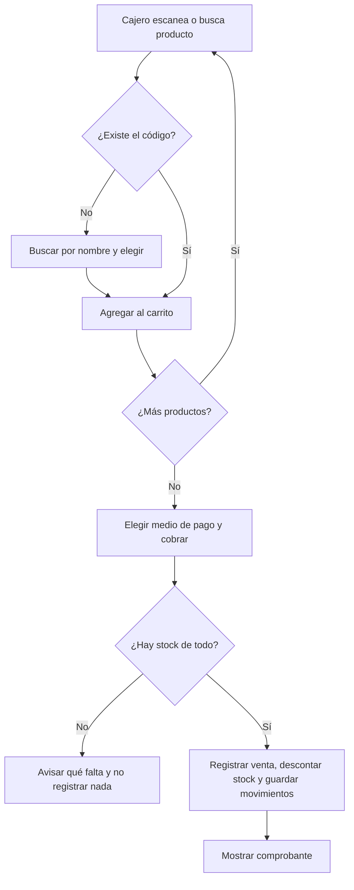

# Despensa — stock y ventas para almacenes de barrio

Sistema web para que un almacén o kiosco controle **stock, ventas, compras a proveedores y vencimientos** desde la computadora del mostrador, sin planillas sueltas ni cuadernos.

Hecho con **Python (Flask) + SQLite**. Sin dependencias pesadas: se instala en minutos y corre en cualquier PC.

## El problema

En un almacén chico el control suele estar en un cuaderno o en la memoria del dueño. Eso trae problemas concretos:

- Se acaba un producto y nadie se da cuenta hasta que lo pide un cliente.
- Se vence mercadería en la góndola.
- No se sabe cuánto se gana de verdad: se mira la caja, no el margen.
- Cuando hay una diferencia de stock no hay forma de rastrear qué pasó.

## Qué hace

| Función | Detalle |
|---|---|
| **Caja** | Venta por código de barras (lector USB) o por nombre. Medios de pago: efectivo, débito, crédito y transferencia. Comprobante imprimible. |
| **Stock** | Alertas de stock bajo y de productos por vencer en los próximos 7 días. |
| **Trazabilidad** | Cada movimiento (venta, compra, ajuste) queda registrado con fecha, usuario y motivo. |
| **Compras** | Ingreso de mercadería por proveedor; suma stock y actualiza costos. |
| **Reportes** | Facturación, ganancia bruta, ticket promedio, ventas por día, más vendidos, medios de pago y productos sin rotación. |
| **Exportar** | Ventas y stock a CSV, que se abre directo en Excel (acentos y separador `;` incluidos). |
| **Usuarios y roles** | `admin` (dueño) ve todo. `cajero` solo vende y consulta productos. |

## Probarlo

```bash
git clone https://github.com/fede-villon/despensa.git && cd despensa
python3 -m venv .venv && source .venv/bin/activate
pip install -r requirements.txt
flask --app app seed      # crea la base con un almacén de ejemplo y 30 días de ventas
flask --app app run       # abrir http://localhost:5000
```

Usuarios de demostración: `admin` / `admin123` y `cajero` / `cajero123`.

Tests:

```bash
python -m pytest -q
```

## Cómo está pensado

### Flujo de una venta



### Decisiones técnicas

- **Toda modificación de stock pasa por un solo módulo** (`app/stock.py`) y dentro de una transacción. Si una venta de 5 productos falla en el último, no se descuenta ninguno.
- **Se guarda el precio y el costo al momento de la venta.** Si mañana sube la yerba, los reportes de ayer siguen dando bien.
- **Tabla de movimientos de stock**: el stock actual siempre se puede reconstruir sumando movimientos. Hay un test que lo verifica.
- **Los productos no se borran, se dan de baja**, para no romper el historial.
- **Precios en pesos enteros**: evita errores de redondeo con decimales.
- **Sin JavaScript obligatorio**: funciona en PCs viejas y con cualquier navegador.

El modelo de datos completo está en [docs/modelo-datos.md](docs/modelo-datos.md).

## Documentación

- [Manual de uso](docs/manual-usuario.md): pensado para el dueño y el cajero, sin lenguaje técnico.
- [Guía de soporte](docs/guia-soporte.md): problemas frecuentes, cómo diagnosticarlos y cómo hacer backup.
- [Modelo de datos](docs/modelo-datos.md): tablas, relaciones y consultas útiles.

## Estructura

```
app/
  __init__.py      arma la aplicación
  db.py            conexión a SQLite y comandos init-db / seed / backup
  schema.sql       tablas
  stock.py         reglas de negocio (ventas, compras, ajustes)
  auth.py          login y permisos
  inicio.py        panel con alertas
  productos.py     ABM de productos y ajustes
  ventas.py        caja y listado de ventas
  compras.py       compras y proveedores
  reportes.py      reportes y exportación CSV
  templates/       pantallas (Jinja)
  static/          estilos
tests/             tests con pytest
docs/              manual, guía de soporte y modelo de datos
```

## Próximos pasos

- Cierre de caja diario (arqueo de efectivo).
- Fiado: cuenta corriente de clientes del barrio.
- Lista de precios con aumento masivo por categoría o proveedor.
- Backup automático diario (hoy existe `flask --app app backup` para hacerlo a mano).

## Sobre el desarrollo

Diseñé el alcance, los flujos y el modelo de datos a partir de cómo trabaja un almacén real. Usé asistentes de IA para acelerar la escritura del código, y revisé, probé y documenté el resultado.
