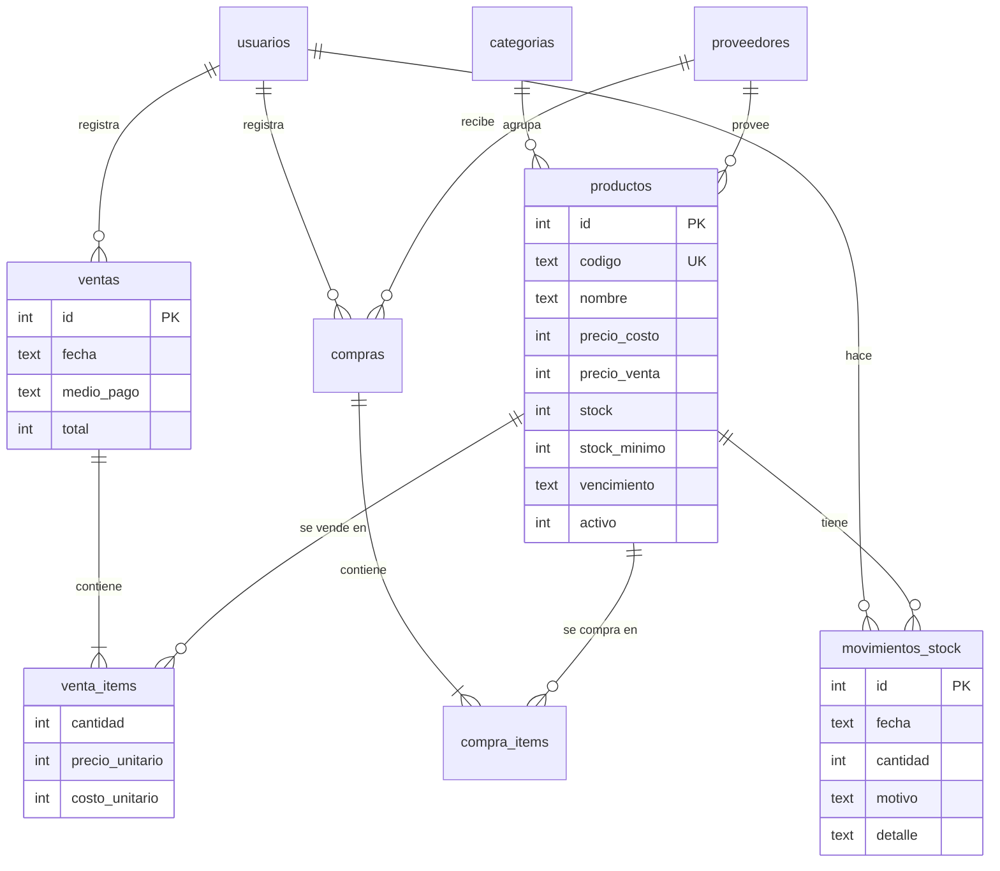

# Modelo de datos

Base SQLite, definida en [`app/schema.sql`](../app/schema.sql). Los montos están en pesos enteros.



## Tablas

| Tabla | Para qué sirve |
|---|---|
| `usuarios` | Quién usa el sistema y con qué rol (`admin` o `cajero`). La contraseña se guarda como hash, nunca en texto. |
| `categorias` | Almacén, Lácteos, Bebidas… para filtrar y para los reportes. |
| `proveedores` | A quién se le compra cada producto. |
| `productos` | Catálogo con precios, stock actual, mínimo y vencimiento. |
| `ventas` / `venta_items` | Cabecera y detalle de cada venta. El detalle guarda precio y costo **del momento**. |
| `compras` / `compra_items` | Ingresos de mercadería. |
| `movimientos_stock` | Bitácora de cada cambio de stock (`venta`, `compra`, `ajuste`, `inicial`). |

## Reglas que garantiza la base

- `stock >= 0`: nunca puede quedar stock negativo (restricción `CHECK`).
- `codigo` único por producto.
- `medio_pago` y `rol` solo aceptan valores válidos.
- Claves foráneas activas (`PRAGMA foreign_keys = ON`).

## Consultas útiles

Ganancia bruta del mes:

```sql
SELECT SUM(vi.cantidad * (vi.precio_unitario - vi.costo_unitario)) AS ganancia
FROM venta_items vi
JOIN ventas v ON v.id = vi.venta_id
WHERE strftime('%Y-%m', v.fecha) = strftime('%Y-%m', 'now', 'localtime');
```

Productos a reponer, agrupados por proveedor (sirve para armar el pedido):

```sql
SELECT pr.nombre AS proveedor, p.nombre, p.stock, p.stock_minimo
FROM productos p JOIN proveedores pr ON pr.id = p.proveedor_id
WHERE p.activo = 1 AND p.stock <= p.stock_minimo
ORDER BY pr.nombre, p.nombre;
```

Verificar que el stock cuadre con los movimientos (diagnóstico de soporte):

```sql
SELECT p.nombre, p.stock, COALESCE(SUM(m.cantidad), 0) AS suma_movimientos
FROM productos p LEFT JOIN movimientos_stock m ON m.producto_id = p.id
GROUP BY p.id
HAVING p.stock <> suma_movimientos;
```


Si devuelve filas, alguien modificó el stock por fuera del sistema.
